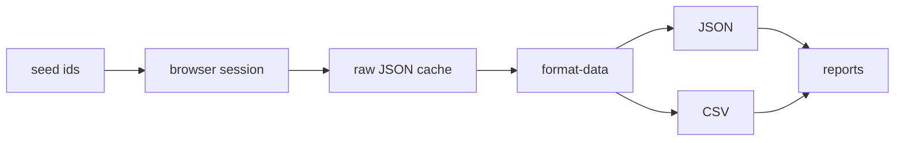

# Proposal: Managing the Scopus pipeline on Bun

Status: draft for approval
Date: 2026-11-11
Project: `scopus-pipeline`
Source project: `../Journal Scraps`

## 1. Why rebuild

The current Python scripts do the job but each script is a standalone file with duplicated browser setup, fragile XPath clicks, and no shared cache contract. They also mix scraping, flattening, and reporting in one place. That makes reruns expensive and failures hard to resume.

The rebuild keeps the proven parts:

- The same Scopus account and institutional session.
- The same gateway endpoints and JSON payloads.
- The same output columns that downstream work already uses.

It changes the parts that cause operational pain:

- No Selenium and no chromedriver dependency.
- No clicking through the author page to trigger network calls.
- Raw JSON is cached first, every derived output is rebuildable.
- One command surface with resumable steps.
- TypeScript types for every payload that crosses a boundary.

## 2. Scope

In scope:

- Author profile collection through the Scopus GraphQL gateway.
- Author document list collection through the profile page network payload.
- Journal metrics and CiteScore collection through the source gateway.
- CSV and JSON outputs.
- Affiliation report and username report.
- Browser and session management.

Out of scope for this phase:

- PDF downloads.
- Citation graph crawling.
- Writing to Scopus.
- Parquet output. Removed by decision, replaced by JSON and CSV.

## 3. Operating model



Four rules drive the design:

1. **The browser is a session, not a scraper.** Chrome is only used to hold the Scopus login and execute same-origin `fetch` calls. There is no fragile DOM interaction in the normal path.
2. **Raw first.** Every network payload is written to `data/raw` before it is flattened. If an output is wrong, rerun format-data instead of scraping again.
3. **Resume by default.** A cached file means the step is done. `--force` is explicit and never implicit.
4. **One direction of data flow.** Seed and raw data go in, JSON and CSV come out. Nothing writes back into raw.

## 4. Command surface

Every workflow is a `bun run` script. Flags pass through after the script name.

### Unified collection flags

```bash
bun run scopus --author --document --journals-quartile
```

| Flag | Step |
|---|---|
| `--author` | fetch author profiles |
| `--document` | fetch author document lists |
| `--journals-quartile` | fetch journal metrics and compute CiteScore quartiles |
| `--all` | run all three steps |

Shared flags: `--seed`, `--ids`, `--source-ids`, `--from-profiles`, `--from-documents`, `--force`, `--limit`, `--wait-ms`, `--no-launch`, `--headless`.

`--seed <file>` selects the author ID file for `--author` and `--document`.

### Setup and health

| Command | Purpose | Safe to rerun |
|---|---|---|
| `bun run login` | create the profile and open the Scopus sign-in page | yes |
| `bun run doctor` | check Bun, browser binary, profile, CDP port, seed files | yes |
| `bun run doctor --deep` | add a live Scopus gateway request | yes |
| `bun run browser` | launch managed Chrome or attach to an existing CDP port | yes |
| `bun run browser status` | browser version, profile path, open tabs | yes |
| `bun run browser close` | close the managed browser | yes |

### Collection

| Command | Purpose | Resume behavior |
|---|---|---|
| `bun run authors:profiles` | author profile batches | skips IDs with a cached profile |
| `bun run authors:documents` | document payload per author | skips IDs with a cached payload |
| `bun run authors:all` | profiles then documents | same |
| `bun run journals:fetch` | journal metrics and CiteScore | skips complete records, retries gateway errors |

Useful flags:

```bash
bun run authors:profiles --seed data/seed/example.csv
bun run authors:profiles --from-profiles
bun run authors:profiles --limit 25
bun run authors:profiles --force
bun run authors:documents --wait-ms 15000
bun run journals:fetch --from-documents
bun run journals:fetch --ids data/seed/example.csv
```

`--no-launch` attaches to a browser that is already running. `--headless` is available only when the profile is already logged in.

### Outputs

| Command | Output |
|---|---|
| `bun run format-data` | all JSON and CSV files |
| `bun run format-data:authors` | `author-profiles.*`, `author-documents.*` |
| `bun run format-data:journals` | `journals.*`, `journal-citescore.*`, `journal-quartiles.*` |
| `bun run report` | affiliation markdown, usernames CSV, non-home CSV, summary JSON |
| `bun run check` | TypeScript typecheck |
| `bun run test` | unit tests |

## 5. Session management

The default is a dedicated profile at `data/browser-profile`. It belongs to this tool, not to the user's daily browser.

One-time setup:

```bash
bun run login
# sign in to Scopus in the window that opens
bun run doctor --deep
```

Why a dedicated profile:

- Chrome only exposes a debug port when it owns the user-data directory.
- A normal daily Chrome session locks the profile and prevents the port from opening.
- The institutional login persists between runs, so signing in is rare.
- Debug flags never touch the user's personal profile.

Attach mode is still supported for ad-hoc use:

```bash
google-chrome --remote-debugging-port=9222
# or brave-browser, chromium, etc.
SCOPUS_CDP_PORT=9222 bun run doctor
```

Session expiry is a first-class failure. A 401, 403, or HTML login page raises `ScopusAuthError` and stops the run instead of writing bad data.

## 6. Rate limits and failure handling

Defaults are deliberately conservative:

- 25 authors per GraphQL request.
- 400 ms between author batches.
- 300 to 550 ms between journal requests.
- 1.5 s between author page loads.
- One browser, one page, no concurrency.

Failure policy:

- A single author failure is logged and skipped. The batch continues.
- An auth failure aborts the run immediately.
- A gateway error for a journal is stored as-is and treated as incomplete, so a later run retries it.
- Partial progress is always saved because files are written one record at a time.

Tuning is environment-only, no code edits:

```bash
SCOPUS_REQUEST_DELAY_MS=800 SCOPUS_JOURNAL_DELAY_MS=600 bun run journals:fetch
```

## 7. Data contracts

### Raw

| Path | Shape | Notes |
|---|---|---|
| `data/raw/author-profiles/{id}.json` | Scopus author object or `null` | `null` is a valid "not found" result |
| `data/raw/author-documents/{id}.json` | `{metadata, items}` | merged from one or more search responses |
| `data/raw/journals/{sourceId}.json` | `{id, journals, citescore}` | `citescore` may be an array, `null`, or a gateway error object |

### Output

`author-profiles.csv|json`

```text
username, username_local, Name, scopus_id, resolved_scopus_id, affiliation,
city, state, country, orcid, documents, citations, cited_by, h_index,
coauthors, institution_history, status
```

`author-documents.csv|json`

```text
scopus_id, eid, document_scopus_id, doi, title, pub_year, document_type,
source_id, source_title, source_publisher, source_issn, source_type,
citations, references, total_authors, authors, author_ids, subject_areas, abstract
```

`journals.csv|json`

```text
id, source_id, source_title, publisher, source_type, metric_year,
sjr, snip, rp, citescore_year, citescore_rankings, citescore_subject_count,
citescore_best_percentile, citescore_quartile, citescore_status
```

`journal-citescore.csv|json` is one row per source, year, and subject code.
`journal-quartiles.csv|json` is one row per source with a CiteScore percentile and quartile.

## 8. Data flow mapping from Python

| Python file | New equivalent | Change |
|---|---|---|
| `main.py` author loop | `authors profiles` | GraphQL through page fetch instead of performance log scraping |
| `main.py` journal loop | `journals fetch` | direct gateway calls instead of opening and closing each journal row |
| `main2.py` profile extraction | `authors profiles` | same payload, typed and cached per author |
| `main2.py` document search | `authors documents` | author-profile document list plus doc-details enrichment |
| `morph.py` | `format-data authors` | JSON output plus CSV, no parquet |
| `cleanup.py` | `format-data authors`, `format-data journals` | schema inference replaced by fixed typed contracts |
| `check_affiliations.py` | `authors profiles`, `report` | same GraphQL query, plus report generation |
| `chromedriver` binary | none | CDP over WebSocket |

## 9. Migration phases

### Phase 0, scaffold (done)

- Bun project, TypeScript, command surface.
- CDP client, browser manager, config, logging.
- Cached legacy data copied to `data/raw` and `data/legacy`.

### Phase 1, author pipeline (done)

- Profile batching, document capture, format-data, report.
- Verified against cached data: 708 profiles, 705 found, 6933 documents, 1104 journals.
- `bun run check` passes.

### Phase 2, journal pipeline (done, one live retry pending)

- Gateway fetch and flattening implemented.
- 147 cached CiteScore records contain `INTERNAL_SERVER_ERROR` and are marked for retry.
- Live retry requires an active Scopus session.

### Phase 3, live validation (next)

- Sign in to the managed profile.
- Run `doctor --deep`.
- Fetch 5 authors with `--force` and compare fields to the cached versions.
- Fetch 10 journals with `--force` and check that CiteScore errors drop.
- Run the full format-data and diff counts against `data/legacy`.

### Phase 4, cutover

- Run both tools for two weeks on the same seed.
- Compare profile, document, and journal counts weekly.
- Archive the Python project read-only.
- Keep `data/legacy` for one quarter.

## 10. Acceptance criteria

The rebuild is accepted when all of these are true:

1. `bun run check` exits 0.
2. `bun run format-data` rebuilds from `data/raw` without network access.
3. Profile count, document count, and journal count match the legacy baseline within an explained tolerance.
4. `bun run report` reproduces the legacy affiliation categories.
5. A cold start works: delete `data/out`, run `bun run format-data`, outputs return.
6. A fresh session works: delete `data/browser-profile`, sign in once, `doctor --deep` passes.
7. An expired session fails loudly and writes no partial records.
8. Re-running any collection command is a no-op for cached IDs.

## 11. Risks and mitigations

| Risk | Impact | Mitigation |
|---|---|---|
| Scopus session expires | collection stops | `doctor --deep`, explicit auth error, one-time manual sign-in |
| Scopus rate limiting or bot checks | slow or blocked runs | conservative delays, one page, no parallel requests, env tuning |
| Gateway route changes | empty or broken payloads | raw payloads retained, adapters isolated per endpoint |
| HTML login page returned as JSON endpoint | parse errors | auth detection and immediate abort |
| Chrome profile lock | no debug port | dedicated `data/browser-profile` by default |
| Data drift between runs | inconsistent reports | raw cache, format-data-only reprocessing, legacy comparison |
| CiteScore internal errors | missing metrics | `citescore_status` column plus retry on incomplete records |
| Large intermediate JSON | disk growth | raw JSON is small, `data/out` is disposable |

## 12. Operational schedule

Suggested cadence:

- Daily or weekly: `authors:profiles`, then `authors:documents`, then `journals:fetch`.
- After each collection: `format-data`, then `report`.
- Weekly: `doctor --deep`.
- Monthly: `--force` on a small sample to detect schema drift.
- Quarterly: prune `data/out` and archive `data/legacy`.

Example cron entries:

```cron
0 2 * * 1 cd "/home/herlanggays/Prof Supri/scopus-pipeline" && bun run authors:all >> data/run.log 2>&1
30 4 * * 1 cd "/home/herlanggays/Prof Supri/scopus-pipeline" && bun run journals:fetch >> data/run.log 2>&1
0 6 * * 1 cd "/home/herlanggays/Prof Supri/scopus-pipeline" && bun run format-data && bun run report >> data/run.log 2>&1
```

## 13. Decisions and open questions

Decisions made:

- Bun and TypeScript, no Node framework, no Selenium.
- CDP over WebSocket, same-origin `fetch` for gateway calls.
- Raw JSON cache plus CSV and JSON outputs.
- Parquet removed.
- Dedicated managed Chrome profile by default.

Open questions:

1. Should document capture also paginate beyond the first search response for very large authors?
2. Should journals with `citescore_status=error` retry automatically on every run, or only with `--force`?
3. Is the report's home-institution pattern final, or should it move to an explicit institution list file?
4. Should raw JSON be committed to git, or stay local with only `data/legacy` committed?
