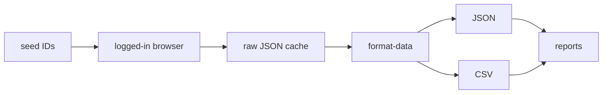

# Scopus Pipeline

A Bun/TypeScript pipeline for Scopus data collection, cleaning, and reporting.

It collects:

- Author profiles: name, email, ORCID, affiliation, metrics, institution history
- Author documents: title, DOI, journal, authors, citations, references, abstract
- Journal metrics: SJR, SNIP, RP, CiteScore, subject rankings, quartiles

It writes JSON and CSV files. No database is required.

This project is a rebuild of the Python scraper in `../Journal Scraps`. It uses the Chrome DevTools Protocol and the same Scopus gateway endpoints as the web app. It does not use Selenium or chromedriver.

## How it works



1. Chrome holds the institutional Scopus session.
2. Bun speaks CDP directly to that browser.
3. Same-origin `fetch` calls hit the Scopus gateway.
4. Documents come from `/gateway/author-profile-api/authors/{id}/documents` and are enriched with `/gateway/doc-details/documents/{eid}`.
5. Every raw payload is saved in `data/raw`.
6. `format-data` flattens raw JSON into JSON and CSV outputs.
7. Reports are built from the formatted profile data.

A cached file means a step is done. Use `--force` to refetch.

## Requirements

- Bun 1.4 or newer
- Chrome, Chromium, Brave, or Edge
- A Scopus account with institutional access

## Install

```bash
cd "/home/herlanggays/Prof Supri/scopus-pipeline"
bun install
```

## First run

```bash
bun run doctor
bun run login
```

`bun run login` creates the managed browser profile at `data/browser-profile` and opens the Scopus sign-in page. Sign in there, then verify:

```bash
bun run doctor --deep
```

Expected output includes:

```text
OK   scopus auth    <id> -> <author name>
```

## Quick start

Collect everything from the default seed:

```bash
bun run scopus --all
```

Then build outputs and reports:

```bash
bun run format-data
bun run report
```

## Command reference

### Setup

| Command | Description |
|---|---|
| `bun run login` | create the profile and open the Scopus login page |
| `bun run doctor` | check Bun, browser, CDP, profile, and seed file |
| `bun run doctor --deep` | make a live Scopus request to verify the session |
| `bun run browser` | launch or attach to Chrome on port 9222 |
| `bun run browser status` | show browser version, profile, and open tabs |
| `bun run browser close` | close the managed browser |

### Collection

| Command | Description |
|---|---|
| `bun run scopus --author` | fetch author profiles |
| `bun run scopus --document` | fetch author document lists |
| `bun run scopus --journals-quartile` | fetch journal metrics and compute quartiles |
| `bun run scopus --all` | run all three collection steps |
| `bun run authors:profiles` | author profiles only |
| `bun run authors:documents` | author documents only |
| `bun run authors:all` | author profiles then documents |
| `bun run journals:fetch` | journal metrics and CiteScore only |

### Formatting and reports

| Command | Description |
|---|---|
| `bun run format-data` | build all JSON and CSV outputs from `data/raw` |
| `bun run format-data:authors` | author outputs only |
| `bun run format-data:journals` | journal outputs only |
| `bun run report` | affiliation markdown, usernames, non-home list, summary JSON |

### Development

| Command | Description |
|---|---|
| `bun run check` | TypeScript typecheck |
| `bun run test` | unit tests |

## Unified collection flags

```bash
bun run scopus --author --document --journals-quartile
```

| Flag | Description |
|---|---|
| `--author` | fetch author profiles |
| `--document` | fetch author document lists |
| `--journals-quartile` | fetch journal metrics and compute quartiles |
| `--all` | run all three steps |
| `--seed <file>` | seed file with author IDs |
| `-i, --ids <file>` | author or source ID file, depending on the step |
| `--source-ids <file>` | source ID file for journal steps |
| `--from-profiles` | use IDs cached in `data/raw/author-profiles` |
| `--from-documents` | derive source IDs from cached author documents |
| `-f, --force` | refetch cached records |
| `-n, --limit <number>` | process at most N records |
| `--wait-ms <number>` | document detail enrichment time per author |
| `--no-details` | skip per-document detail enrichment, faster but no abstracts |
| `--no-launch` | attach to a running browser instead of launching one |
| `--headless` | launch headless, only for an already logged-in profile |

Run `bun run scopus --help` for the full list.

## Examples

Use a custom seed file:

```bash
bun run scopus --author --document --seed data/seed/example.csv
bun run authors:profiles --seed data/seed/example.csv
bun run journals:fetch --seed data/seed/example.csv
```

Test with a small sample:

```bash
bun run authors:profiles --limit 5
bun run authors:documents --limit 5
bun run journals:fetch --limit 10
```

Refresh cached data:

```bash
bun run scopus --all --force --limit 25
```

Run offline after collection:

```bash
bun run format-data
bun run report
```

## Seed files

Author seed files can be:

- A plain text file with one Scopus author ID per line
- A CSV with an `Auth-ID` column
- A CSV with a `scopus_id` column

Default seed: `data/seed/example.csv`, which contains fake IDs. Put real seed files in `data/seed/` locally. They are ignored by git.

Source ID files for journals can be plain text or CSV with one Scopus source ID per line.

## Data layout

```text
data/
  seed/
    example.csv                fake default seed, tracked
  raw/
    author-profiles/           {authorId}.json, GraphQL payload or null
    author-documents/          {authorId}.json, normalized document list
    journals/                  {sourceId}.json, {id, journals, citescore}
  out/                         generated outputs
  legacy/                      optional reference outputs from the Python project
  browser-profile/             managed browser profile
```

Raw and output data are ignored by git. Seed files are tracked.

## Outputs

All outputs are written to `data/out`.

### Author profiles

- `author-profiles.csv`
- `author-profiles.json`

Columns:

```text
username, username_local, Name, scopus_id, resolved_scopus_id, affiliation,
city, state, country, orcid, documents, citations, cited_by, h_index,
coauthors, institution_history, status
```

### Author documents

- `author-documents.csv`
- `author-documents.json`

Columns:

```text
scopus_id, eid, document_scopus_id, doi, title, pub_year, document_type,
source_id, source_title, source_publisher, source_issn, source_type,
citations, references, total_authors, authors, author_ids, subject_areas, abstract
```

### Journals

- `journals.csv`
- `journals.json`

Columns:

```text
id, source_id, source_title, publisher, source_type, metric_year,
sjr, snip, rp, citescore_year, citescore_rankings, citescore_subject_count,
citescore_best_percentile, citescore_quartile, citescore_status
```

- `journal-citescore.csv`
- `journal-citescore.json`

One row per source, year, and subject code.

- `journal-quartiles.csv`
- `journal-quartiles.json`

One row per journal with a CiteScore percentile and quartile.

### Reports

- `scopus-affiliation-report.md`
- `scopus-usernames.csv`
- `scopus-non-home-affiliations.csv`
- `scopus-affiliation-summary.json`

## Quartiles

Quartiles are derived from the best CiteScore subject percentile for the latest year:

| Percentile | Quartile |
|---|---|
| 75 to 100 | Q1 |
| 50 to 74.99 | Q2 |
| 25 to 49.99 | Q3 |
| 0 to 24.99 | Q4 |

If CiteScore is missing or the gateway returns an error, the quartile is blank and `citescore_status` is `missing` or `error`.

## Configuration

Bun loads `.env` automatically. Start from the example:

```bash
cp .env.example .env
```

| Variable | Default | Description |
|---|---|---|
| `SCOPUS_CDP_PORT` | `9222` | Chrome DevTools port |
| `CHROME_BIN` | auto-detect | browser executable |
| `CHROME_USER_DATA_DIR` | `data/browser-profile` | persistent profile directory |
| `CHROME_PROFILE_DIRECTORY` | `Scopus` | profile subdirectory |
| `SCOPUS_PROFILE_BATCH_SIZE` | `25` | authors per GraphQL request |
| `SCOPUS_REQUEST_DELAY_MS` | `400` | delay between author batches |
| `SCOPUS_JOURNAL_DELAY_MS` | `300` | delay between journal requests |
| `SCOPUS_DOCUMENT_WAIT_MS` | `120000` | detail enrichment time per author |
| `DATA_DIR` | `data` | root data directory |
| `SEED_AUTHOR_IDS` | `seed/example.csv` | default author seed |
| `HOME_INSTITUTION_PATTERN` | `$^` (matches nothing) | affiliation report matching |
| `LOG_LEVEL` | `info` | `debug`, `info`, `warn`, `error` |

## Session management

The managed profile is dedicated to this tool.

Why a separate profile:

- Chrome only exposes a debug port when it owns the user-data directory
- The institutional login persists between runs
- Debug flags never touch the daily browser profile

`bun run login` reopens the login page at any time. If Scopus expires the session, collection stops with `ScopusAuthError` instead of writing bad data.

## Resume behavior

| Step | Cached at | Skip rule |
|---|---|---|
| author profiles | `data/raw/author-profiles/{id}.json` | file exists |
| author documents | `data/raw/author-documents/{id}.json` | file exists |
| journals | `data/raw/journals/{sourceId}.json` | source title exists and CiteScore is not a gateway error |

Use `--force` to override.

## Troubleshooting

### `no Chrome CDP endpoint on port 9222`

```bash
bun run login
```

Or start a browser manually:

```bash
brave-browser --remote-debugging-port=9222
```

### `Scopus session is not authorized (HTTP 403)`

The session expired or the profile is not logged in.

```bash
bun run login
bun run doctor --deep
```

### `Chrome did not open port 9222`

Another Chrome instance is already using the profile directory. Close that instance or use the managed profile.

### `no source IDs found`

Fetch author documents first, or pass a source seed file:

```bash
bun run scopus --document
bun run scopus --journals-quartile
# or
bun run journals:fetch --seed data/seed/example.csv
```

### CiteScore errors

A journal record can contain `citescore_status=error` when Scopus returns `INTERNAL_SERVER_ERROR`. Rerun with `--force` later.

### Too slow or rate limited

Increase delays:

```bash
SCOPUS_REQUEST_DELAY_MS=1000 SCOPUS_JOURNAL_DELAY_MS=800 bun run scopus --all
```

## Development

```bash
bun run check
bun run test
```

Project structure:

```text
src/
  cli.ts                 command definitions
  config.ts              env and paths
  cdp/                   browser launch, CDP client, network recorder
  scopus/                authors, documents, journals, session
  format-data/           raw JSON to JSON and CSV
  commands/              CLI command implementations
  lib/                   CSV, filesystem, logger
  report.ts              affiliation reports
tests/
  format-data.test.ts    flattening and quartile tests
  seed.test.ts           seed parsing tests
```

See `PROPOSAL.md` for the operating plan, migration phases, and acceptance criteria.
